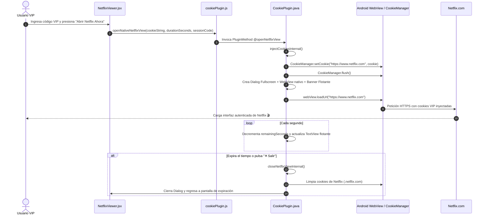

# 🎬 App Net — Plataforma de Gestión y Acceso VIP a Netflix

> **Documento de Arquitectura y Referencia Técnica**  
> Última actualización: Octubre 2026

---

## 📌 1. ¿De qué trata la aplicación?

**App Net** es una plataforma híbrida (Web + APK Nativo Android vía Capacitor) desarrollada para comercializar y gestionar accesos VIP temporales a Netflix sin necesidad de compartir contraseñas ni correos con los clientes finales.

### Características Clave:
1. **Acceso por Licencias / Pases VIP**: Los usuarios adquieren códigos (ej. `VIP-PREMIUM-2026`, `VIP-PRUEBA`) con una duración configurada en minutos (ej. 60 min, 1440 min = 24h).
2. **Autenticación transparente mediante Cookies**:
   - Cada pase tiene asignada una sesión de cookies de Netflix (`NetflixId`, `SecureNetflixId`, etc.).
   - Al pulsar *"Abrir Netflix Ahora"*, la app inyecta las cookies en el motor web nativo de Android.
3. **Visor Nativo Integrado (In-App WebView)**:
   - Netflix carga **dentro de la misma app** a pantalla completa (sin salirse a Chrome externo ni navegadores ajenos).
   - Muestra un **banner flotante superior** con el temporizador regresivo en vivo y un botón `✕ Salir`.
4. **Cierre Automático y Purga de Sesión**:
   - Al expirar el tiempo de la licencia (o cuando el usuario presiona salir), el visor nativo se cierra automáticamente y **se borran todas las cookies** del sistema para proteger la cuenta.
5. **Panel de Administración Completo (`/admin` o PIN `2026`)**:
   - Generación de licencias con duración personalizada.
   - **Editor de Cookies integrado** compatible con:
     - Formato Netscape / TSV (copiado directo de la extensión Cookie-Editor).
     - Formato JSON array exportado por Cookie-Editor.
     - Pares clásicos `nombre=valor;`.
   - Pool de cuentas compartidas o asignación individual.
   - Personalización visual de la página de inicio (landing) y planes de precios.

---

## 🏗️ 2. Arquitectura del Proyecto

```
APP NET/
├── android/                                    # Proyecto nativo Android (Capacitor)
│   ├── app/src/main/java/com/appnet/app/
│   │   ├── MainActivity.java                   # Punto de entrada de la actividad Android
│   │   └── CookiePlugin.java                   # 🌟 Plugin nativo: inyección de cookies y WebView full-screen con temporizador
│   └── build/outputs/apk/debug/app-debug.apk   # APK compilado listo para instalar
│
├── src/                                        # Frontend React + Vite + TailwindCSS
│   ├── components/
│   │   ├── NetflixLanding.jsx                  # Página pública con catálogo, planes y botón de acceso
│   │   ├── Login.jsx                           # Formulario de validación de códigos VIP
│   │   ├── NetflixViewer.jsx                   # Dashboard del usuario VIP con temporizador y botón de lanzamiento
│   │   └── AdminPanel.jsx                      # Panel administrativo, editor de licencias y visor de cookies
│   ├── services/
│   │   ├── authService.js                      # Lógica de validación de pases, Firestore y fallback local
│   │   ├── firebase.js                         # Configuración de Firebase Firestore
│   │   └── cookiePlugin.js                     # 🌉 Puente JS entre React y el CookiePlugin nativo
│   ├── App.jsx                                 # Router de estados y control de sesión
│   └── index.css                               # Estilos globales y tokens Tailwind
│
├── capacitor.config.json                       # Configuración de Capacitor (com.appnet.app)
├── app-debug.apk                               # Acceso directo al último APK generado
└── README_APP_NET.md                           # Este documento de referencia
```

---

## ⚡ 3. Flujo Técnico de Inyección y Visor (Android Native)



---

## 🍪 4. Formatos de Cookies Soportados por el Admin Panel

El parser en `AdminPanel.jsx` y `CookiePlugin.java` procesa de forma transparente:

1. **Formato Netscape / Tab-Separated Values (TSV)**:
   ```tsv
   .netflix.com	TRUE	/	TRUE	0	NetflixId	ct%3D...
   .netflix.com	TRUE	/	TRUE	0	SecureNetflixId	v%3D3%26...
   ```
2. **Formato JSON (Cookie-Editor Extension)**:
   ```json
   [
     {
       "name": "NetflixId",
       "value": "ct%3D...",
       "domain": ".netflix.com",
       "path": "/",
       "secure": true
     }
   ]
   ```
3. **Formato Par Estándar**:
   ```
   NetflixId=ct%3D...; SecureNetflixId=v%3D3...;
   ```

---

## 🛠️ 5. Comandos de Desarrollo y Compilación

### Iniciar entorno web local (desarrollo frontend):
```powershell
npm run dev
```

### Compilar frontend y sincronizar con Android:
```powershell
npm run build
npx cap sync android
```

### Compilar APK Debug (con JDK 21 y Android SDK configurados):
```powershell
$env:JAVA_HOME = "E:\jdk21\jdk-21.0.12.1+1"
$env:ANDROID_HOME = "E:\AndroidSDK\Sdk"
npx cap sync android
cd android
.\gradlew assembleDebug
cd ..
Copy-Item -Path "android\app\build\outputs\apk\debug\app-debug.apk" -Destination "app-debug.apk" -Force
```

---

## 🔮 6. Hoja de Ruta para Futuras Actualizaciones

- [ ] **Soporte para múltiples perfiles protegidos**: Asignación automática de perfil bloqueado con PIN dentro de la misma cuenta.
- [ ] **Rotación automática de cookies expiradas**: Detección de sesión caída y auto-reemplazo desde el pool activo en Firestore.
- [ ] **Integración de Pasarelas de Pago Automáticas**: MercadoPago / Binance Pay / Stripe para generación instantánea de licencias al pagar.
- [ ] **Modo Web Bookmarklet**: Generador de marcadores de 1 clic para usuarios que prefieran ver Netflix en PC/navegador sin instalar extensiones manuales.
