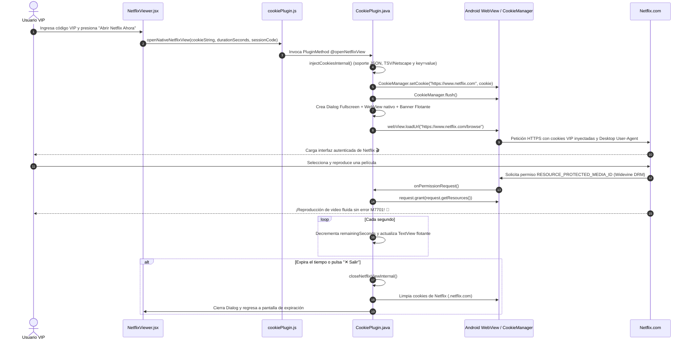

# 🎬 Netflix Plus (v1.1) — Plataforma de Gestión y Acceso VIP a Netflix

> **Documento de Arquitectura, Referencia Técnica y Registro de Actualizaciones**  
> Última actualización: Octubre 2026

---

## 📌 1. ¿De qué trata la aplicación?

**Netflix Plus** es una plataforma híbrida (Web + APK Nativo Android vía Capacitor) desarrollada para comercializar y gestionar accesos VIP temporales a Netflix sin necesidad de compartir contraseñas ni correos con los clientes finales.

### Características Clave:
1. **Acceso por Licencias / Pases VIP**: Los usuarios adquieren códigos (ej. `VIP-PREMIUM-2026`, `TEST`) con una duración configurada en minutos (ej. 60 min, 1440 min = 24h).
2. **Autenticación transparente mediante Cookies**:
   - Cada pase tiene asignada una sesión de cookies de Netflix (`NetflixId`, `SecureNetflixId`, etc.).
   - Al pulsar *"Abrir Netflix Ahora"*, la app inyecta las cookies en el motor web nativo de Android.
3. **Visor Nativo Integrado (In-App WebView)**:
   - Netflix carga **dentro de la misma app** a pantalla completa (sin salirse a Chrome externo ni navegadores ajenos).
   - Muestra un **banner flotante superior** con el temporizador regresivo en vivo y un botón `✕ Salir`.
4. **Reproducción de Video DRM Widevine Habilitada**:
   - Concesión automática de permisos de medios protegidos (`RESOURCE_PROTECTED_MEDIA_ID`) para reproducir películas y series sin bloqueos DRM.
5. **Cierre Automático y Purga de Sesión**:
   - Al expirar el tiempo de la licencia (o cuando el usuario presiona salir), el visor nativo se cierra automáticamente y **se borran todas las cookies** del sistema para proteger la cuenta.
6. **Panel de Administración Completo (`/admin` o PIN `2026`)**:
   - Generación de licencias con duración personalizada.
   - **Editor de Cookies integrado** compatible con:
     - Formato Netscape / TSV (copiado directo de la extensión Cookie-Editor con tabulaciones).
     - Formato JSON array exportado por Cookie-Editor.
     - Pares clásicos `nombre=valor;`.
   - Pool de cuentas compartidas o asignación individual.
   - Sincronización en tiempo real con **Firebase Firestore** (`setDoc` con `{ merge: true }`).
   - Personalización visual de la página de inicio (landing) y planes de precios.

---

## 🏗️ 2. Arquitectura del Proyecto

```
APP NET/
├── android/                                    # Proyecto nativo Android (Capacitor)
│   ├── app/src/main/java/com/appnet/app/
│   │   ├── MainActivity.java                   # Punto de entrada de la actividad Android
│   │   └── CookiePlugin.java                   # 🌟 Plugin nativo: inyección de cookies, WebView full-screen, soporte DRM y temporizador
│   ├── app/src/main/res/values/strings.xml     # Configuración del nombre: "Netflix Plus"
│   └── build/outputs/apk/debug/app-debug.apk   # APK compilado
│
├── src/                                        # Frontend React + Vite + TailwindCSS
│   ├── components/
│   │   ├── NetflixLanding.jsx                  # Página pública con catálogo, planes y botón de acceso
│   │   ├── Login.jsx                           # Formulario de validación de códigos VIP
│   │   ├── NetflixViewer.jsx                   # Dashboard del usuario VIP con temporizador y botón de lanzamiento
│   │   └── AdminPanel.jsx                      # Panel administrativo, editor de licencias y visor de cookies
│   ├── services/
│   │   ├── authService.js                      # Lógica de validación de pases, Firestore y fallback local
│   │   ├── firebase.js                         # Configuración de Firebase Firestore
│   │   └── cookiePlugin.js                     # 🌉 Puente JS entre React y el CookiePlugin nativo
│   ├── App.jsx                                 # Router de estados y control de sesión
│   └── index.css                               # Estilos globales y tokens Tailwind
│
├── firestore.rules                             # Reglas de seguridad de base de datos Firestore
├── firebase.json                               # Configuración de Firebase
├── capacitor.config.json                       # Configuración de Capacitor (appName: "Netflix Plus")
├── Netflix-Plus-v1.1.apk                       # 📦 APK de distribución listo para instalar
├── app-debug.apk                               # Acceso directo al último APK generado
└── README_APP_NET.md                           # Este documento de referencia y changelog
```

---

## ⚡ 3. Flujo Técnico de Inyección, DRM y Visor (Android Native)



---

## 🍪 4. Formatos de Cookies Soportados

Tanto en [`AdminPanel.jsx`](file:///e:/APP%20NET/src/components/AdminPanel.jsx) como de forma nativa en [`CookiePlugin.java`](file:///e:/APP%20NET/android/app/src/main/java/com/appnet/app/CookiePlugin.java) se procesan:

1. **Formato Netscape / Tab-Separated Values (TSV)**:
   ```tsv
   .netflix.com	TRUE	/	TRUE	0	NetflixId	ct%3DBgjHlOvcAxLnA1...
   .netflix.com	TRUE	/	TRUE	0	SecureNetflixId	v%3D3%26...
   ```
2. **Formato JSON (Cookie-Editor Extension)**:
   ```json
   [
     {
       "name": "NetflixId",
       "value": "ct%3D...",
       "domain": ".netflix.com",
       "path": "/",
       "secure": true
     }
   ]
   ```
3. **Formato Par Estándar**:
   ```
   NetflixId=ct%3D...; SecureNetflixId=v%3D3...;
   ```

---

## 📝 5. Historial Completo de Actualizaciones (Changelog)

### 🚀 Update v1.5 (Octubre 2026 - Soporte DRM Widevine y Eliminación del Error M7701)
- **Problema detectado**: Al intentar reproducir una película o serie, la pantalla se ponía estática con el mensaje: *"Sentimos la interrupción... Visita chrome://settings/content/protectedContent... Código de error M7701-1003"*.
- **Causa**: El `WebView` de Android bloqueaba silenciosamente la solicitud de identificador de contenido protegido (`RESOURCE_PROTECTED_MEDIA_ID`) requerida por Widevine CDM.
- **Solución implementada**:
  - Implementación del callback `onPermissionRequest` en el `WebChromeClient` de `CookiePlugin.java` para aprobar automáticamente las solicitudes de DRM, audio y video.
  - Actualización del User-Agent a una versión certificada de ChromeOS (`Mozilla/5.0 (X11; CrOS x86_64 14541.0.0) ...`).
  - Nombre oficial actualizado en `strings.xml` y `capacitor.config.json` a **Netflix Plus**.
  - Generación del archivo ejecutable **`Netflix-Plus-v1.1.apk`**.

### 🚀 Update v1.4 (Octubre 2026 - Desktop User-Agent contra bloqueo móvil)
- **Problema**: Al inyectar la cookie con éxito, Netflix reconocía la cuenta (`Gérer le compte`), pero mostraba la pantalla publicitaria bloqueante: *"L'expérience Netflix est meilleure avec l'app"*.
- **Solución**: Se sustituyó el User-Agent móvil por versión de escritorio en `CookiePlugin.java`. Netflix desbloqueó de inmediato la selección de perfiles y el catálogo completo.

### 🚀 Update v1.3 (Octubre 2026 - Parser Nativo TSV / Netscape en Android)
- **Problema**: Las cookies exportadas desde Cookie-Editor en formato texto plano con tabulaciones (`\t`) se guardaban tal cual en Firestore, pero Java solo parseaba JSON o punto y coma, ignorando los valores de `NetflixId`.
- **Solución**: Se implementó el parser nativo de texto Netscape/TSV en `CookiePlugin.java`, extrayendo nombre, valor y dominio por cada línea tabulada.

### 🚀 Update v1.2 (Octubre 2026 - Sincronización en vivo con Firebase Firestore)
- **Problema**: En nuevos navegadores o dispositivos las cookies no se reflejaban porque Firestore bloqueaba la escritura con `Missing or insufficient permissions`.
- **Solución**:
  - Creación de [`firestore.rules`](file:///e:/APP%20NET/firestore.rules) y [`firebase.json`](file:///e:/APP%20NET/firebase.json) con permisos de lectura y escritura para pases y pool de cookies.
  - Cambio en `authService.js` de `updateDoc` a `setDoc(..., { merge: true })` para garantizar la persistencia automática de documentos nuevos.

### 🚀 Update v1.1 (Octubre 2026 - Corrección de propiedad `assignedCookie`)
- **Problema**: `validateAccessPass` retornaba `internalCookie` en vez de `assignedCookie`, provocando que el componente `NetflixViewer` enviara un string vacío al plugin nativo.
- **Solución**: Estandarización de la propiedad `assignedCookie` en todas las respuestas de `authService.js`.

### 🚀 Update v1.0 (Octubre 2026 - Visor Nativo In-App con Temporizador Flotante)
- **Problema**: `window.open` abría Google Chrome externo, donde el almacenamiento de cookies es independiente del de la aplicación.
- **Solución**: Creación de `openNetflixView` en `CookiePlugin.java` con WebView a pantalla completa y barra flotante con temporizador en vivo y botón de auto-cierre.

---

## 🛠️ 6. Comandos de Compilación del APK

Para compilar un nuevo APK tras cualquier modificación en el proyecto:

```powershell
# 1. Compilar frontend React
npm run build

# 2. Sincronizar y compilar APK en Android
$env:JAVA_HOME = "E:\jdk21\jdk-21.0.12.1+1"
$env:ANDROID_HOME = "E:\AndroidSDK\Sdk"
npx cap sync android
cd android
.\gradlew assembleDebug
cd ..
Copy-Item -Path "android\app\build\outputs\apk\debug\app-debug.apk" -Destination "Netflix-Plus-v1.1.apk" -Force
Copy-Item -Path "android\app\build\outputs\apk\debug\app-debug.apk" -Destination "app-debug.apk" -Force
```

---

## 🔮 7. Hoja de Ruta para Futuras Actualizaciones

- [ ] **Soporte para múltiples perfiles protegidos**: Asignación automática de perfil bloqueado con PIN dentro de la misma cuenta.
- [ ] **Rotación automática de cookies expiradas**: Detección de sesión caída y auto-reemplazo desde el pool activo en Firestore.
- [ ] **Integración de Pasarelas de Pago Automáticas**: MercadoPago / Binance Pay / Stripe para generación instantánea de licencias al pagar.
- [ ] **Modo Web Bookmarklet**: Generador de marcadores de 1 clic para usuarios que prefieran ver Netflix en PC/navegador sin instalar extensiones manuales.
